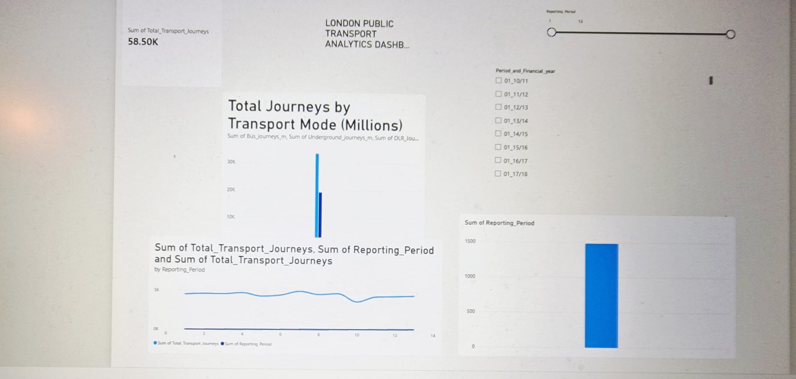

# London Public Transport Data Engineering Pipeline

### End-to-End Data Engineering Project Using Microsoft Fabric

## 1. Project Overview

This project demonstrates an end-to-end data engineering pipeline built using Microsoft Fabric. It uses publicly available London public transport data to demonstrate data ingestion, transformation, storage, SQL analytics and business intelligence reporting.

The project follows the Medallion Architecture, consisting of Bronze, Silver and Gold layers.

The objective is to transform raw transport data into structured, analytical datasets and develop insights into London's public transport system.

## 2. Project Objectives

- Ingest and store public transport data.
- Build a Lakehouse using Microsoft Fabric.
- Implement Bronze, Silver and Gold data layers.
- Transform data using PySpark.
- Perform analytical queries using SQL.
- Develop an interactive Power BI dashboard.
- Demonstrate practical cloud data engineering skills.

## 3. Architecture

The project follows the Medallion Architecture.

### Bronze Layer – Raw Data
- Stores the original public transport dataset.
- Preserves the ingested data for further processing.
- Table: `dbo.public_transport_journeys`

### Silver Layer – Cleaned Data
- Selects relevant transport columns.
- Organises the dataset for analytical processing.
- Table: `public_transport_silver`

### Gold Layer – Analytics-Ready Data
- Calculates total journeys across transport modes.
- Creates a dataset suitable for reporting and analysis.
- Table: `public_transport_gold`

## 4. Technologies Used

| Technology | Purpose |
|---|---|
| Microsoft Fabric | Cloud data engineering platform |
| Fabric Lakehouse | Data storage |
| PySpark | Data transformation |
| SQL | Data analysis |
| Delta Lake | Table storage |
| Power BI | Data visualisation |
| GitHub | Project documentation and version control |

## 5. Dataset

The project uses publicly available London public transport journey data associated with Transport for London (TfL).

The dataset includes journey information for:

- Bus
- London Underground
- DLR
- Tram
- London Overground
- London Cable Car
- TfL Rail

The dataset contains 215 records in the processed Bronze table.

## 6. Data Engineering Process

The project involved:

1. Loading the transport dataset into Microsoft Fabric.
2. Creating a Lakehouse.
3. Storing the ingested data in the Bronze layer.
4. Selecting and transforming relevant columns using PySpark.
5. Creating the Silver layer.
6. Calculating total transport journeys.
7. Creating the Gold layer.
8. Querying the Gold data using SQL.

## 7. SQL Analytics

SQL was used to analyse transport journey volumes.

The analysis included:

- Total journeys by transport mode.
- Percentage contribution of each transport mode.
- Average and maximum journey volumes.
- Reporting-period analysis.
- Comparison of transport modes.

## 8. Power BI Dashboard

An interactive dashboard was developed using the Gold layer.

It includes:

- Total public transport journeys KPI.
- Total journeys by transport mode.
- Public transport journeys over time.
- Reporting-period filter.
- Financial-year filter.

## 9. Key Findings

The SQL analysis identified approximately **58,497.41 million journeys** across all transport modes in the dataset.

Bus accounted for approximately 57.2% of total journeys, while the Underground represented approximately 32.9%.

These findings demonstrate the importance of buses and the Underground within London's public transport network.

## 10. Pipeline Execution Status

The Fabric pipeline was created and successfully validated.

However, execution  However, execution encountered a Microsoft Fabric Spark capacity limitation (HTTP 430). Therefore, successful automated pipeline execution has not yet been confirmed.

The notebook transformations and Gold-layer analysis were successfully executed separately.

11. Future Improvements

Resolve Spark capacity limitations.

Complete and validate automated pipeline execution.

Implement scheduled data ingestion.

Add data quality validation.

Expand the dataset with additional transport information.

Develop more advanced analytical dashboards.

12. Author

Developed as a practical portfolio project to demonstrate cloud data engineering, data transformation, SQL analytics and business intelligence skills using Microsoft Fabric.

Project: London Public Transport Data Engineering Pipeline

Architecture: Bronze → Silver → Gold

Technologies: Microsoft Fabric | PySpark | SQL | Power BI | Delta Lake
## 13. Project Architecture

The following diagram illustrates the end-to-end data engineering workflow.

## 14. Power BI Dashboard

The dashboard provides insights into transport journeys, transport modes and reporting periods.

## Project Architecture

## Power BI Dashboard

The dashboard visualises London public transport journeys, compares transport modes and analyses journey trends over time.

